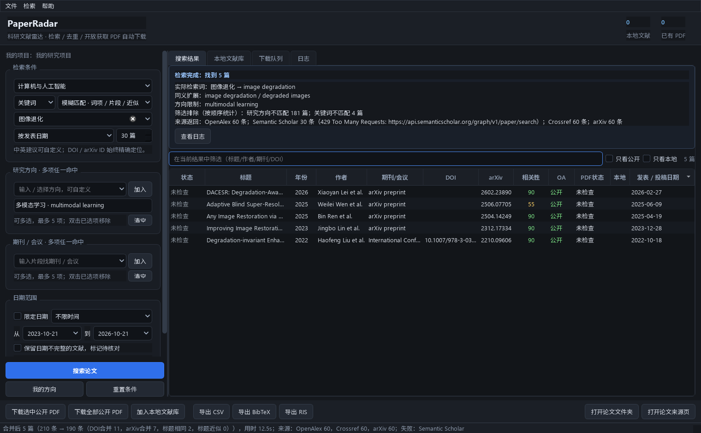

# PaperRadar · 科研文献雷达 v1.3.1

本地 Windows 科研文献工具：跨学科检索、模糊匹配、日历筛选、公开 PDF 获取与验证、本地文献库及 CSV / BibTeX / RIS 导出。

## 快速开始（源码）

推荐 Windows 10/11、Python 3.12。克隆仓库后运行：

```powershell
git clone https://github.com/AnthonyHan-ux/PaperRadar.git
cd PaperRadar
py -3.12 -m venv .venv
.\.venv\Scripts\python.exe -m pip install -r requirements.txt
.\.venv\Scripts\python.exe main.py
```

命令行检索和离线测试：

```powershell
.\.venv\Scripts\python.exe cli.py search -q "medical image segmentation" --limit 20
.\.venv\Scripts\python.exe -m pytest tests -q
```

仓库保存源码和默认配置模板；运行数据、个人配置、PDF、缓存和打包产物不会上传。用户数据默认保存在 `%LOCALAPPDATA%\PaperRadar\data`。API 凭据只在本机设置，模板中的凭据字段保持为空。

需要 Windows 可执行程序时，请按第 9 节运行 `build.ps1`；`Start-PaperRadar.bat` 和 `Check-PaperRadar.bat` 适用于已安装到 `%LOCALAPPDATA%\Programs\PaperRadar-1.3.1` 的本机版本。首次使用源码请按上述命令启动。

## 当前版本

检索区新增跨学科建议：8 类学科、87 个中英主题、60 个期刊/会议。下拉选项可输入片段或简称补全，仍可手工输入；期刊和方向各支持最多 5 项。推荐属于人工整理的常用示例，不是实时热度或质量排名。

1.3.1 在结果区直接显示正在检索、实际英文检索词、各来源返回/失败状态和筛选排除原因；零结果提供取消期刊、取消方向或仅关键词重搜按钮。新增图像退化、图像恢复等显式中英词条及常见多模态别名。自定义中文无对照时明确提示，不冒充通用机器翻译。严格筛选下仍可能没有结果；放宽条件由用户主动选择。

默认模糊检索，支持词项片段、词序变化和部分轻微拼写差异；也可切换连续词组精确匹配。DOI/arXiv ID 始终按标识符定位。输入不完整标题即可找候选；召回仍受来源索引、语言、限流和返回数量限制。内置中英别名可转换，自定义中文不会被当作任意机器翻译。

日期使用日历，支持 `YYYY-MM-DD`、近 7 天/30 天/3 个月/一年和自定义范围，含首尾日期。arXiv 使用首投稿日期，其他来源使用其记录的发表日期。来源只给年份或月份时保留原精度；不能确定落入范围的文献默认排除，可选保留待核对。日期会保存到文献库，并显示在表格、详情及 CSV 中。首次打开旧库时升级至 schema v4；非空库先备份，备份失败则停止升级。

示例：`PaperRadarCLI.exe search -q "neural network" --match-mode fuzzy --date-from 2024-02-01 --date-to 2024-02-29 --venues "Nature Machine Intelligence"`。原 `--from/--to` 年份参数继续可用。日期检索的验证说明见 `docs/VALIDATION_V1_3.md`。

本地运行的**学术文献雷达 + 开放获取 PDF 下载器 + 本地文献库**。  
输入一个关键词：多源检索 → 去重合并 → 相关性排序 → 查找合法公开全文 → 下载 → 校验真伪 → 入库 → 导出。



> 只访问合法公开来源（arXiv / OpenAlex / Semantic Scholar / Crossref / Unpaywall / OpenReview）。
> **不访问 Sci-Hub，不绕过付费墙，不破解验证码。** 找不到会明确告诉你原因。

---

## 1. 安装与启动

1. 解压整个 `PaperRadar` 文件夹（**不要只拿 exe**，`_internal` 是运行依赖）。
2. 双击 `PaperRadar.exe`。
3. 首次启动会在 `%LOCALAPPDATA%\PaperRadar\data` 建立数据库、文献库和配置。

程序目录可以放在桌面、U 盘或 `Program Files`——**运行数据不再写在程序目录里**。

### 命令行版（批量审计用）

```
dist\PaperRadar\cli\PaperRadarCLI.exe --version
dist\PaperRadar\cli\PaperRadarCLI.exe stats
```

---

## 2. 数据保存在哪里（重要）

| 内容 | 位置 |
| --- | --- |
| 论文数据库 | `%LOCALAPPDATA%\PaperRadar\data\database\paperradar.db` |
| PDF 文献库 | `%LOCALAPPDATA%\PaperRadar\data\library\<年份>\<期刊或会议>\` |
| 你的配置 | `%LOCALAPPDATA%\PaperRadar\data\config\user_config.yaml` |
| 研究方向 | `%LOCALAPPDATA%\PaperRadar\data\config\research_profile.yaml` |
| 日志 | `%LOCALAPPDATA%\PaperRadar\data\logs\app.log` |
| 缓存 / 临时文件 / 导出 | `...\data\cache`、`tmp`、`exports` |

**备份就是复制整个 `%LOCALAPPDATA%\PaperRadar\data` 文件夹。** 数据库、PDF、配置都在里面。

程序会自动：

- 升级数据库 schema 前备份为 `paperradar.db.pre-migration.<时间>`（保留最近 3 个）；
- 检测到数据库损坏时，把损坏文件改名为 `paperradar.db.corrupt.<时间>` 并以空库启动（**不会删除**损坏文件）；
- 配置文件损坏时备份为 `user_config.broken.<时间>.yaml` 并回退到默认配置；
- 清理超过 24 小时的下载残留 `*.part`（不会动正在下载的文件）。

---

## 3. 基本使用

**搜索**：左侧选择检索方式（关键词 / 标题 / 作者 / DOI / arXiv ID / 研究方向），填关键词，可选年份、会议期刊、研究方向过滤，点「搜索论文」。

**下载**：选中论文 → 底部「下载选中公开 PDF」；或「下载全部公开 PDF」。没有公开副本的论文会标注原因，不会尝试绕过付费墙。

**本地文献库**：右侧「本地文献库」标签页，勾选「只看已下载 PDF」可过滤；双击打开 PDF 或来源页。

**导出**：底部「导出 CSV / BibTeX / RIS」，未选中时导出当前全部结果。CSV 带 UTF-8 BOM，Excel 直接打开不乱码。

**我的方向**：点左侧「我的方向」编辑关键词、加分词、排除词、优先期刊，保存后按这些条件打分排序。

### 检索排序

默认按本次查询的元数据词项匹配排序，可切换为“我的研究方向”或“发表年份”。
查询匹配与个人方向分开计算，悬停相关性列可查看另一个参考分、命中词和缺失摘要提示。
分数是检索辅助信息，不代表论文质量、研究结论可信度或相关概率。

新安装不预设学科关键词、排除词或期刊名单。会议、期刊和方向过滤可以自由输入，多个条件用分号分隔。
已有用户配置和数据继续保留；遥感配置位于 examples/*_remote_sensing.yaml，作为可选示例。

### 个人研究方向评分（仅在选择该排序时使用）

| 通道 | 权重 | 满分条件 |
| --- | --- | --- |
| 标题命中 | 40 | 命中 2 个不同关键词 |
| 摘要命中 | 30 | 命中 4 个 |
| 关键词字段命中 | 15 | 命中 3 个 |
| 研究方向匹配 | 10 | 命中 1 个 |
| 优先期刊/会议 | 5 | 命中即得 |
| 排除词 | 每命中 1 个 −15（最多 −30） | — |

`≥90 高度相关`、`70–89 较相关`、`50–69 可能相关`、`<50 低相关`。鼠标悬停「相关性」列可看到每一分的来源。

---

## 4. PDF 状态含义

| 状态 | 含义 | 你该做什么 |
| --- | --- | --- |
| `VALIDATED` | 已下载，标题区匹配通过且无已知身份冲突 | 重要引用仍应核对原文 |
| `TITLE_WARNING` | 已下载，但标题相似度 80–90、作者/DOI 证据待确认，或 PDF 无文本层（扫描件） | 打开确认一下 |
| `PUBLIC_BUT_BLOCKED` | **确认存在公开副本**，但服务器拒绝自动下载（403/401） | 点「打开论文来源页」手动下载 |
| `PAYWALLED_ONLY` | 有明确证据表明只有付费版本 | 通过学校/机构订阅获取 |
| `NO_PUBLIC_COPY_FOUND` | 没有找到公开副本（不代表一定付费） | 可换关键词再试，或在机构图书馆查 |
| `MISSING_LOCAL_FILE` | 数据库有记录，但本地 PDF 文件被移动/删除了 | 重新下载，或手动放回 |
| `DOWNLOAD_FAILED` | 有候选链接但下载失败（网络/文件不可用） | 稍后重试 |
| `WRONG_PAPER` | 下载到的 PDF 不是目标论文 | 可手动从来源页下载 |
| `INVALID_PDF` | 不是有效 PDF（HTML 错误页/登录页/损坏） | 同上 |

`NO_PUBLIC_COPY_FOUND` 与 `PAYWALLED_ONLY` 严格区分：没有结构化证据就不会说「付费墙」。

---

## 5. 批量审计（比如一次处理 99 篇标题）

准备 `titles.txt`（每行一个标题，`#` 开头是注释）或 CSV（需要 `title` 列）：

```powershell
cd dist\PaperRadar
.\cli\PaperRadarCLI.exe audit --titles titles.txt --out audit.csv --resume
.\cli\PaperRadarCLI.exe stats
.\cli\PaperRadarCLI.exe stats --downloads-csv downloads.csv
```

- 每条标题：检索 → 选最匹配的记录（相似度 <85 记为 `NO_MATCH`）→ 找公开 PDF → 下载 → 校验 → **立即写入一行**。
- 中途断了直接重跑，`--resume` 仅跳过最近一次为 `VALIDATED` 的标题；网络失败、未匹配、被阻止和待确认项会重试。若记录的本地文件已丢失，也会重试。
- `audit.csv` 字段：`index, input_title, status, pdf_status, matched_title, match_score, year, venue, doi, arxiv_id, oa_status, path, url, message, elapsed_s, attempt, attempted_at`。
- 新审计 CSV 记录尝试次数和 UTC 时间；旧格式续跑时保持原有列数，已有历史不会被覆盖。
- `downloads.csv` 字段：`id, timestamp, title, doi, provider, status, reason, http_status, url, local_path`。

---

## 6. 命令行速查

```powershell
PaperRadarCLI.exe search -q "medical image segmentation" --sort-by query --from 2023 --to 2026 --limit 20 --save
PaperRadarCLI.exe download -q "cloud removal" --limit 5
PaperRadarCLI.exe audit --titles titles.txt --out audit.csv --resume
PaperRadarCLI.exe stats [--downloads-csv downloads.csv]
PaperRadarCLI.exe profile
PaperRadarCLI.exe export --format bib --out library.bib --only-local
PaperRadarCLI.exe cache clear
PaperRadarCLI.exe --version
```

中文乱码时可用 `chcp 65001`，或在 Windows Terminal 里运行（程序已自动使用 UTF-8 输出）。

---

## 7. 配置

用户配置：`%LOCALAPPDATA%\PaperRadar\data\config\user_config.yaml`

```yaml
api:
  openalex_mailto: "you@example.com"    # 联系邮箱；遵守服务当前额度与限流
  unpaywall_email: "you@example.com"    # 启用 Unpaywall（必须有邮箱）
  semantic_scholar_api_key: ""          # 可选，缓解 S2 429
  timeout_seconds: 30
  cache_ttl_hours: 24
download:
  max_workers: 3
  min_pdf_bytes: 10000
  validate_title_threshold: 90
search:
  provider_timeout_seconds: 40          # 整轮检索硬上限 = 该值 × 1.5
```

- 建议至少填 `openalex_mailto`；不填 `unpaywall_email` 时 Unpaywall 层自动跳过。
- 升级不会覆盖你的配置；新增配置项会用默认值补齐。
- 修改后重启程序生效。

---

## 8. 从 V1.0 升级（自动迁移）

V1.0 把数据放在程序目录（`<程序目录>\database`、`library`、`config`）。V1.1 首次启动会：

1. 在 `%LOCALAPPDATA%\PaperRadar\data\migration_backup_<时间>` 创建备份；
2. 用 SQLite 在线备份 API 复制数据库（WAL 安全），然后做完整性检查、对比论文数量；
3. 复制文献库（PDF 一个不丢）和配置文件；
4. 写入 `migration.json` 标记，之后不会再迁移。

**迁移不会删除或修改旧目录里的任何文件**；迁移失败会自动继续使用旧目录，程序照常可用。详见 [docs/MIGRATION.md](docs/MIGRATION.md)。

---

## 9. 从源码运行 / 打包

```powershell
python -m venv .venv
.\.venv\Scripts\python.exe -m pip install -r requirements.txt
.\.venv\Scripts\python.exe main.py

# 打包（自动跑测试 + 打包 + 自检）
powershell -ExecutionPolicy Bypass -File build.ps1
```

产物：`dist\PaperRadar\PaperRadar.exe`（GUI）和 `dist\PaperRadar\cli\PaperRadarCLI.exe`（CLI）。

> `build.ps1` 必须是纯 ASCII 或 UTF-8 **带 BOM**，否则 Windows PowerShell 5.1 会把中文当成乱码导致语法错误。
> 国内网络默认走清华镜像，需要官方源时加 `-OfficialPyPI`。

---

## 10. 故障排查

| 现象 | 处理 |
| --- | --- |
| 检索慢或个别来源失败 | 看日志；Semantic Scholar 429 属正常限流，配 API key 可缓解 |
| 大量 `PUBLIC_BUT_BLOCKED` | 目标站点反爬（Elsevier、MDPI 常见），用「打开来源页」手动下载 |
| 大量 `NO_PUBLIC_COPY_FOUND` | 确认填了 `unpaywall_email`；部分论文没有可发现的公开副本，缺少公开链接不等于确认只有付费版本 |
| 双击 exe 没反应 | 查看 [Windows 启动说明](docs/STARTUP_WINDOWS.md)；日志位于 `%LOCALAPPDATA%\PaperRadar\data\logs\app.log` |
| 想换数据盘 | 设置环境变量 `PAPERRADAR_HOME=D:\PaperRadarData`（该目录不会被自动迁移，需手动放置数据） |
| 中文输出乱码 | `chcp 65001`，或使用 Windows Terminal |
| 数据库异常 | 程序会自动隔离损坏文件；备份在 `...\database\paperradar.db.corrupt.*` |

---

## 11. 已知限制

1. Semantic Scholar 未认证时容易 429（共享 IP），失败自动降级，不影响其他源。
2. Unpaywall 必须配置邮箱，否则该层跳过。
3. 不实现网页爬取补漏（CVF/PMLR/作者主页/GitHub 等留待后续版本）。
4. 扫描版 PDF 无文本层时只能给 `TITLE_WARNING`。
5. 内置会场别名保留兼容性；任何学科均可使用，自定义会场不受名单限制，未知别名归入 `Other` 目录。
6. 大数据集（>1 万篇）的去重依赖标题指纹分桶，极端相似但前缀不同的标题可能漏合并。

---

## 12. 合规声明

本工具只对**合法公开**文献做自动化整理：不绕过访问控制，不访问侵权镜像，不破解验证码，不伪造身份。所有下载行为等同于你在浏览器中打开一个公开 PDF。


## 13. v1.2.0 可靠性改进

- PDF 身份不再由 DOI 子串或正文引用单独判定；标题只在首页标题区比较，作者或 DOI 冲突提示人工复核。
- 搜索结果和数据库统一保护不同 DOI/arXiv ID、已知作者冲突和 Part I/II、不同数字标题。
- Crossref 单篇 DOI 查询按官方接口请求；404 与限流、服务错误明确区分。
- 已有 PDF 链接失效后补查一次，只尝试新增候选；单篇和批量使用同一恢复路径，取消后不继续补查。
- DOI 补查后才发现的 arXiv ID 也会生成下载候选。
- 检索分数、学科配置与失败续跑规则见上述章节。

标题相似度仍是启发式证据：缺少标识符、作者和年份关系时不能证明两份记录属于同一作品。
本版保留无冲突元数据下原有的标题匹配兼容逻辑；预印本/正式版完整关系管理、
多路主题查询、来源分页和大规模跨学科验收尚待后续实现。
详见 docs/VALIDATION_V1_2.md，本版测试不使用用户真实数据库。

数据库访问被拒绝、被占用或只读时保留原库并报告错误；只有 SQLite 明确报告损坏时才隔离备份。
